<div align="center">

<picture>
  <source media="(prefers-color-scheme: dark)" srcset="docs/assets/banner-dark.png">
  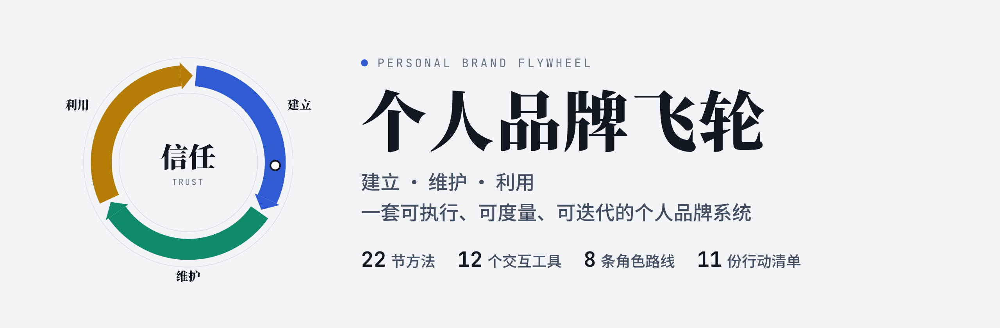
</picture>

<h3>如何建立、维护、利用个人品牌？</h3>

一份打开就能用的交互式指南：**22 节方法 · 12 个交互工具 · 8 条角色路线 · 11 份行动清单**

<p>
  <a href="https://vx-zjr.github.io/personal-brand-flywheel/"></a>
</p>

<p>
  <a href="CHANGELOG.md"></a>
  <a href="https://github.com/vx-zjr/personal-brand-flywheel/actions/workflows/pages.yml"></a>
  <a href="LICENSE-CONTENT"></a>
  <a href="LICENSE"></a>
  
  
</p>

<a href="https://vx-zjr.github.io/personal-brand-flywheel/">在线体验</a> ·
<a href="#content-map">内容地图</a> ·
<a href="#tools">交互工具</a> ·
<a href="#quick-start">快速开始</a> ·
<a href="#iterate">如何迭代</a> ·
<a href="CHANGELOG.md">更新日志</a>

</div>

---

## ✨ 这是什么

个人品牌不是自我包装，而是把你的能力和声誉变成别人**看得见、说得清、愿意推荐**的东西。

这个项目把“建立 → 维护 → 利用”做成一个首尾相接的**飞轮**：每一次利用品牌带来的案例、收入和关系，都会成为下一轮建立的证据，飞轮越转越快。每一节都配有清单、模板或交互工具，读完就能动手。你填写的内容只保存在你自己的浏览器里，最后可以一键导出成一份《个人品牌战略书》。

<table>
  <tr>
    <td width="25%" valign="top"><b>🧭 可执行</b><br><sub>22 节方法，每节至少一份清单、模板或工具</sub></td>
    <td width="25%" valign="top"><b>📊 可度量</b><br><sub>品牌体检雷达图、指标仪表盘、90 天计划，季度复测对比</sub></td>
    <td width="25%" valign="top"><b>🧩 可交互 · 可视化</b><br><sub>12 个工具、7 张概念图、全文搜索、深色模式、手机适配</sub></td>
    <td width="25%" valign="top"><b>🔁 可托管 · 可迭代</b><br><sub>零依赖单文件，推送即自动部署；agent.md 规定更新流程</sub></td>
  </tr>
</table>

## 🖼️ 截图

<table>
  <tr>
    <td width="50%">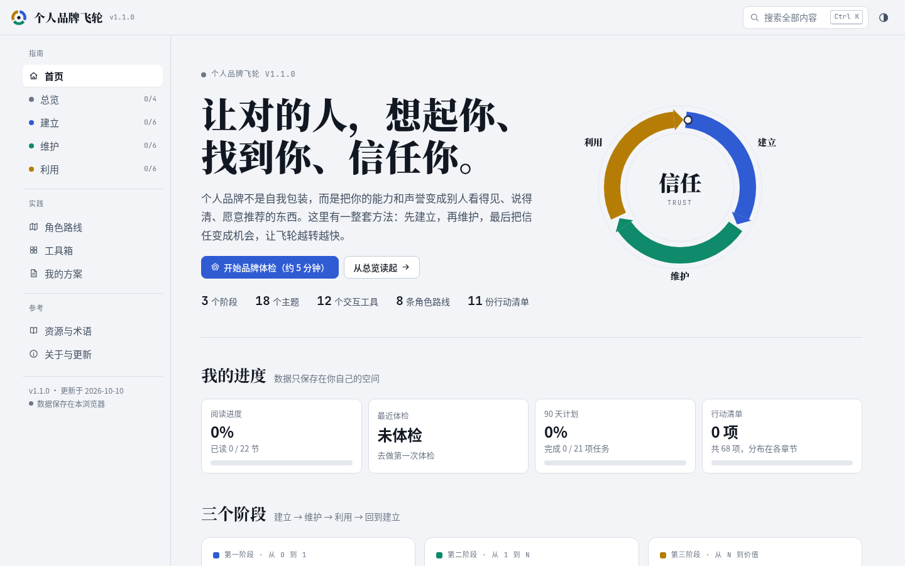<br><sub>首页：飞轮模型与“我的进度”</sub></td>
    <td width="50%">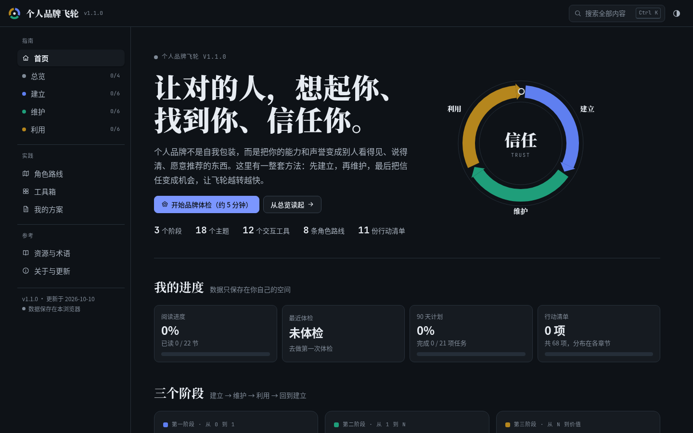<br><sub>深色模式，自动跟随系统</sub></td>
  </tr>
  <tr>
    <td>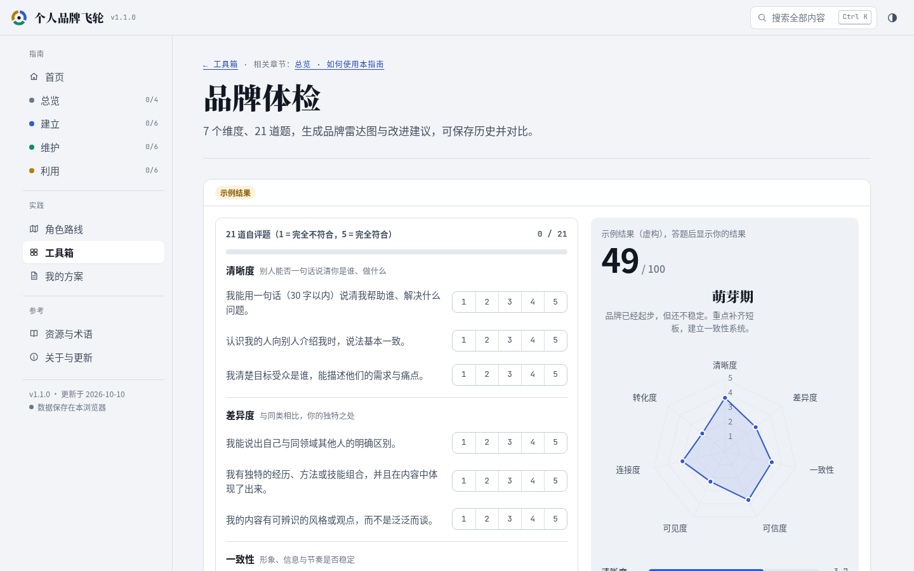<br><sub>品牌体检：7 个维度、21 道题、雷达图与短板建议</sub></td>
    <td>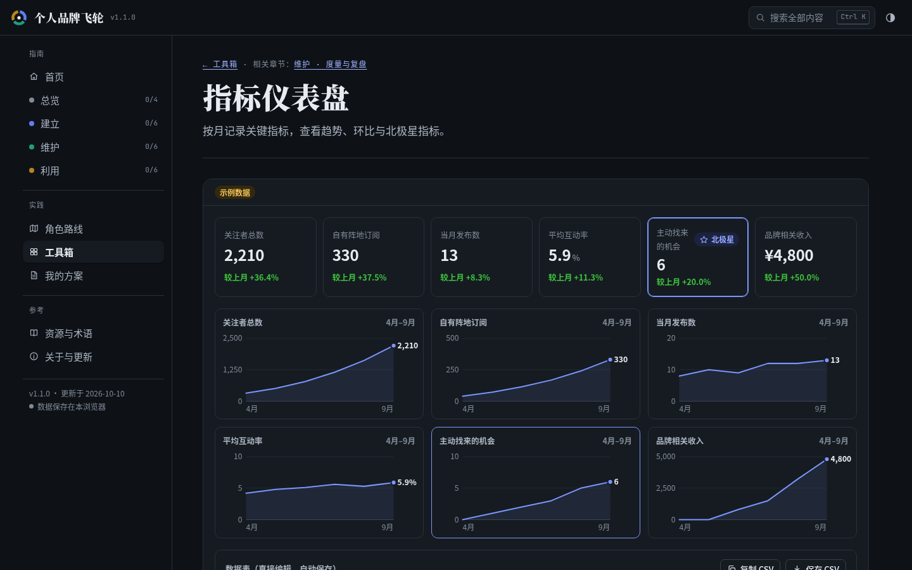<br><sub>指标仪表盘：环比、北极星指标与趋势小多图</sub></td>
  </tr>
  <tr>
    <td>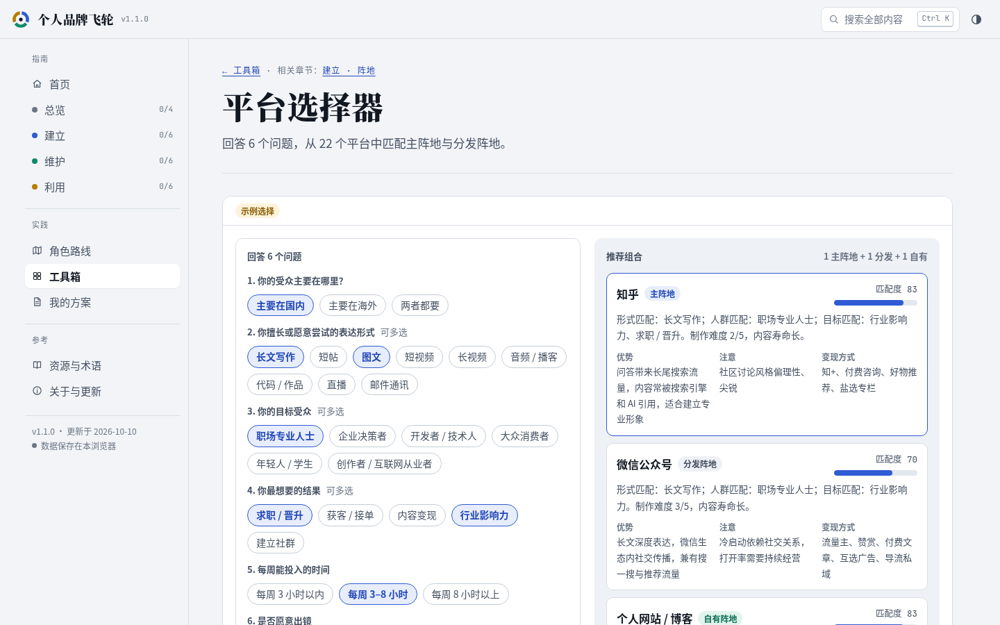<br><sub>平台选择器：6 个问题，从 22 个平台中匹配主阵地</sub></td>
    <td>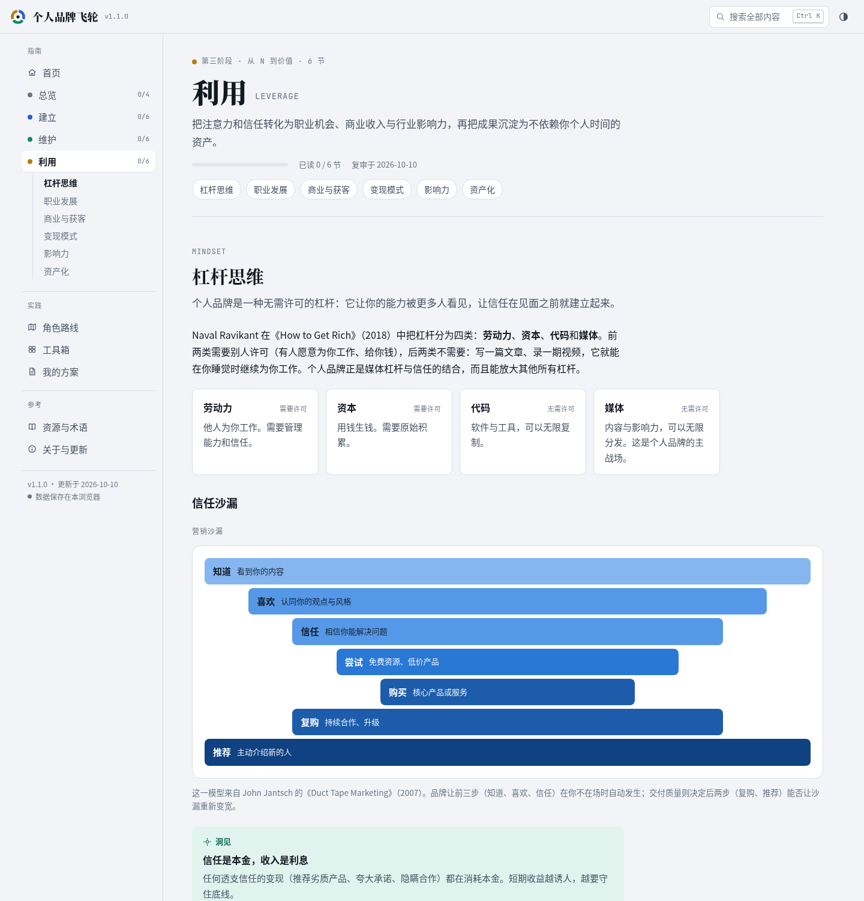<br><sub>章节页：方法、卡片与概念图（营销沙漏）</sub></td>
  </tr>
</table>

<p align="center">
  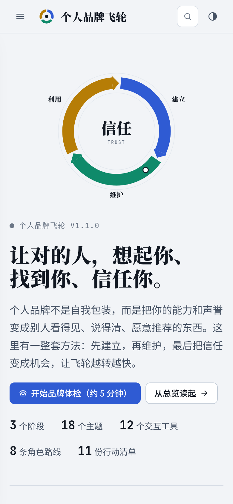
  &nbsp;&nbsp;
  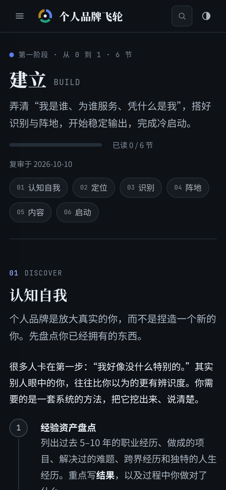
  <br><sub>手机端同样完整可用</sub>
</p>

<a id="content-map"></a>

## 🗺️ 内容地图

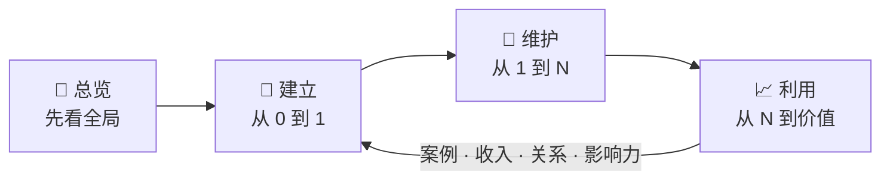

| 章节 | 小节 | 配套工具 |
|---|---|---|
| 🧭 **总览** | 个人品牌是什么 · 为什么现在更重要 · 飞轮模型 · 如何使用本指南 | 品牌体检 |
| 🌱 **建立** | 认知自我 → 定位 → 识别 → 阵地 → 内容 → 启动 | 品牌原型 · 定位画布 · 领域评估 · 平台选择器 · 内容日历 · 90 天计划 |
| 🔁 **维护** | 一致性系统 · 社群与关系 · 度量与复盘 · 声誉管理 · 进化与转型 · 可持续 | 指标仪表盘 · 危机应对 |
| 📈 **利用** | 杠杆思维 · 职业发展 · 商业与获客 · 变现模式 · 影响力 · 资产化 | 变现计算器 |
| 🧑‍🤝‍🧑 **角色路线** | 职场专业人士 · 技术开发者 · 自由职业者 · 内容创作者 · 创业者 · 学生 · 企业高管 · 转型者 | 每条路线都有可勾选的关键动作 |
| 📚 **资源** | 19 本书 · 8 篇经典文章 · 26 个术语 · 10 个常见问题 | 全文搜索（<kbd>Ctrl</kbd>/<kbd>⌘</kbd> + <kbd>K</kbd>） |

<details>
<summary><b>展开：每章讲了什么</b></summary>

- **总览**：个人品牌的定义（被记住、被信任、被推荐）；AI 时代为什么更重要：内容通胀、AI 先于人认识你、职业路径非线性；贯穿全书的飞轮模型。
- **建立**：经验资产盘点与他人反馈；四圈交集找甜蜜区；12 种品牌原型；定位公式与差异化策略；名字、头像、三种长度的简介、语调与品牌故事；自有、租用、赢得三类阵地；内容支柱、原子化与生产流水线；冷启动五步与 90 天计划。
- **维护**：维护节奏表与五个坚持方法；关系网络与从受众到社群；五层指标与三种复盘法；数字足迹自查、让 AI 准确认识你、危机应对五步；年度审计与平滑转型；防倦怠、隐私、账号安全与法律合规要点。
- **利用**：四种杠杆与营销沙漏；职业机会与内部品牌；内容获客漏斗与创始人品牌；12 种变现模式、价值阶梯与 1000 个铁杆粉丝；思想领导力与演讲资料包；资产化与风险清单。

</details>

<a id="tools"></a>

## 🧰 12 个交互工具

所有工具都会先展示一份带“示例”标记的数据，你一开始编辑，它就变成你自己的数据并自动保存。

| 工具 | 能做什么 | 直达 |
|---|---|---|
| 📡 品牌体检 | 7 维度 × 3 题，生成雷达图、等级与短板建议，可保存历史并对比 | [打开](https://vx-zjr.github.io/personal-brand-flywheel/#tools.audit) |
| 🎭 品牌原型 | 从 12 种原型中选主、辅原型，得到语调关键词与内容方向 | [打开](https://vx-zjr.github.io/personal-brand-flywheel/#tools.archetype) |
| 🎯 定位画布 | 填 11 个字段，自动生成 4 种定位陈述、3 种长度的简介和 30 秒电梯演讲 | [打开](https://vx-zjr.github.io/personal-brand-flywheel/#tools.canvas) |
| ⚖️ 领域评估 | 按热爱、擅长、需求、变现、竞争、持久性给候选领域加权打分 | [打开](https://vx-zjr.github.io/personal-brand-flywheel/#tools.niche) |
| 🧱 平台选择器 | 回答 6 个问题，从 22 个国内外平台中推荐主阵地、分发阵地和自有阵地 | [打开](https://vx-zjr.github.io/personal-brand-flywheel/#tools.platform) |
| 🗓️ 内容日历 | 按内容支柱占比与发布节奏生成 4 周日历，选题池按 ICE 排序，可导出 CSV | [打开](https://vx-zjr.github.io/personal-brand-flywheel/#tools.calendar) |
| 🚩 90 天计划 | 四阶段 21 项任务的冷启动路线图，甘特条自动标出当前周 | [打开](https://vx-zjr.github.io/personal-brand-flywheel/#tools.roadmap) |
| 📈 指标仪表盘 | 按月记录 6 项指标，查看环比、趋势小多图，设定北极星指标 | [打开](https://vx-zjr.github.io/personal-brand-flywheel/#tools.metrics) |
| 🛡️ 危机应对 | 回答几个问题，得到应对步骤与可复制的声明模板 | [打开](https://vx-zjr.github.io/personal-brand-flywheel/#tools.crisis) |
| 💰 变现计算器 | 铁杆粉丝正算与反算，价值阶梯月收入估算 | [打开](https://vx-zjr.github.io/personal-brand-flywheel/#tools.money) |
| 💬 品牌顾问 | 带着你的定位画布与体检结果向 Claude 提问（在 Claude 中打开时可用） | [说明](https://vx-zjr.github.io/personal-brand-flywheel/#tools.advisor) |
| 📄 我的方案 | 把所有工具的结果汇总成 Markdown 品牌战略书，支持备份、导入与清空 | [打开](https://vx-zjr.github.io/personal-brand-flywheel/#plan) |

> [!TIP]
> 时间不多？只做三件事：[品牌体检](https://vx-zjr.github.io/personal-brand-flywheel/#tools.audit) → 用[定位画布](https://vx-zjr.github.io/personal-brand-flywheel/#tools.canvas)写出一句话定位 → 用 [90 天计划](https://vx-zjr.github.io/personal-brand-flywheel/#tools.roadmap)跟踪执行。

<a id="quick-start"></a>

## 🚀 快速开始

**直接使用**：打开 👉 **https://vx-zjr.github.io/personal-brand-flywheel/**，不需要注册或安装。

**本地运行**（只需要 Python 3，没有任何第三方依赖）：

```bash
git clone https://github.com/vx-zjr/personal-brand-flywheel.git
cd personal-brand-flywheel
python3 scripts/build.py                        # 校验内容并构建 dist/
python3 -m http.server 8765 --directory dist    # 打开 http://localhost:8765
```

也可以直接双击 `dist/index.html`，它是一个完整的单文件。

## 🏗️ 项目结构与架构

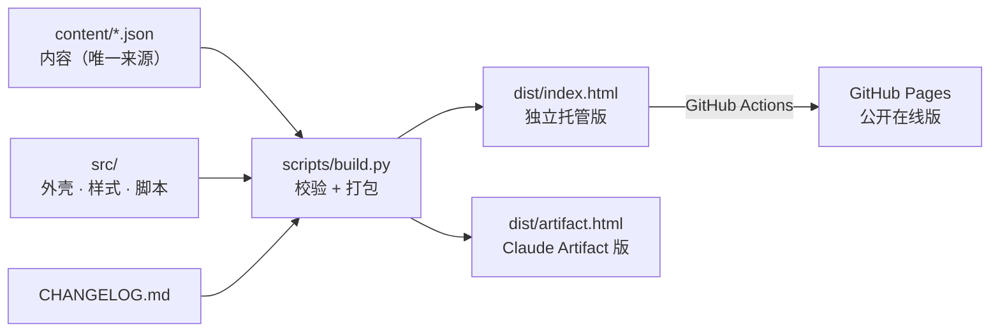

```text
personal-brand-flywheel/
├── agent.md            ★ 智能体协作手册（AGENTS.md / CLAUDE.md 都指向它）
├── content/            ★ 全部内容：章节、角色路线、工具数据、资源（JSON）
├── src/                外壳 HTML、样式（设计令牌）、按文件拆分的脚本与静态资源
├── scripts/build.py    内容校验与打包（仅 Python 标准库）
├── dist/               构建产物：index.html · artifact.html · og.png
├── docs/assets/        README 用的横幅与截图
└── .github/workflows/  推送后自动构建并部署到 GitHub Pages
```

构建脚本会检查：JSON 结构与必填字段、站内链接是否可达、清单与任务 ID 是否重复、工具与图示是否都有实现、平台与危机决策树数据是否自洽、AI 提示词占位符，以及法规类内容是否超过复审期限。

<a id="iterate"></a>

## 🔁 如何迭代

这个项目从一开始就按“持续更新”来设计，所有规则写在 [**agent.md**](agent.md) 里：目录结构、内容模型、10 个常见任务的操作配方、版本规则、编辑准则和迭代日志。

```text
改 content/*.json  →  python3 scripts/build.py  →  更新版本号与 CHANGELOG  →  git push  →  自动部署上线
```

让 AI 智能体维护时，直接这样说就行：

- “按 agent.md 的 R7，刷新所有标记为易变的小节，并发布新版本。”
- “按 R4 新增一个‘个人网站检查器’工具，嵌入‘阵地’一节。”
- “读取 GitHub 上的 Issue，按 R8 处理。”

> [!NOTE]
> 内容有保鲜期：每个小节都记录了复审日期，含法规、平台规则的小节每 90 天复审一次，其余 180 天，构建时会自动提醒。

## 🚢 部署

| 方式 | 说明 |
|---|---|
| **GitHub Pages** | 推送到 `main` 后，[工作流](.github/workflows/pages.yml)自动校验、构建，并把 `dist/index.html` 发布到 `gh-pages` 分支 |
| **Claude Artifact** | `dist/artifact.html` 可以发布为 Claude Artifact，额外提供私有云端同步、AI 建议、文件下载与逐节评论 |
| **任意静态托管** | Vercel、Netlify、Cloudflare Pages、对象存储，上传 `dist/index.html` 即可 |

页面零外部依赖，唯一的外部请求是可选的 Google Fonts，被拦截时会自动回退到系统字体，所以在国内网络下也能正常打开。

## 🔒 数据与隐私

- 你在工具里填写的内容只保存在**你自己的浏览器**中（localStorage），没有服务器、账号或统计追踪。
- 在 Claude 中打开 Artifact 版并登录时，数据还会同步到只有你自己能读取的私有存储。
- “我的方案”页可以随时导出 JSON 备份、导入或一键清空。

## 🛣️ 路线图

- [ ] 英文版
- [ ] 更多角色路线：医生、律师、教师、设计师、销售
- [ ] 内容日历导出 iCal（.ics）
- [ ] 体检结果分享卡片
- [ ] “品牌手册”独立页：自动生成语调规范
- [ ] 给时间更少的读者的“14 天冲刺”路线

## 🤝 参与贡献

- 发现错误或有建议：在线版每一节末尾都有 **“去 GitHub 提建议”**，会打开一条预填好页面位置的 [Issue](https://github.com/vx-zjr/personal-brand-flywheel/issues)。
- 想直接改内容：修改 `content/` 中的 JSON，运行 `python3 scripts/build.py --strict` 确认通过后提交 PR。改动前请先读 [agent.md](agent.md) 的内容准则：不编造数据、引用要可核实、法规写明生效日期。

## 📜 许可证

| 部分 | 许可证 | 范围 |
|---|---|---|
| 内容 | [CC BY 4.0](LICENSE-CONTENT) | `content/` 中的文字与数据、`agent.md`、README、CHANGELOG、`docs/` 中的图片 |
| 代码 | [MIT](LICENSE) | `src/`、`scripts/`、`.github/` |

`dist/` 中的构建产物同时包含两者，各部分分别适用对应的许可证。转载或改编内容时，请注明“**个人品牌飞轮 / vx-zjr**”并附上本仓库链接；如有修改，请加以说明。

## 🙏 致谢

内容参考了许多经典的著作与文章，包括 Al Ries 与 Jack Trout 的《定位》、Austin Kleon 的 *Show Your Work!*、Donald Miller 的 *Building a StoryBrand*、Kevin Kelly 的 *1,000 True Fans*、Naval Ravikant 关于杠杆的论述，以及 Mark Granovetter 的《弱连接的力量》。完整书单与文章见在线版的[资源与术语](https://vx-zjr.github.io/personal-brand-flywheel/#resources)。

> [!IMPORTANT]
> 本指南中的法律、税务与平台规则信息仅供一般参考，不构成专业意见；规则会变化，请以官方最新发布为准。文中示例人物均为虚构。

<div align="center">
<br>
<sub>如果这份指南对你有帮助，欢迎点一个 ⭐ Star，或者把它分享给正在打造个人品牌的朋友。</sub>
<br><br>
<a href="#top">回到顶部 ↑</a>
</div>
